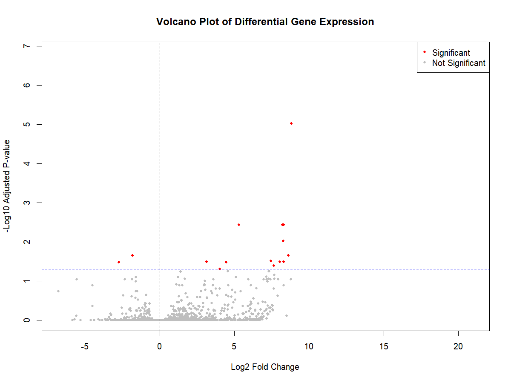
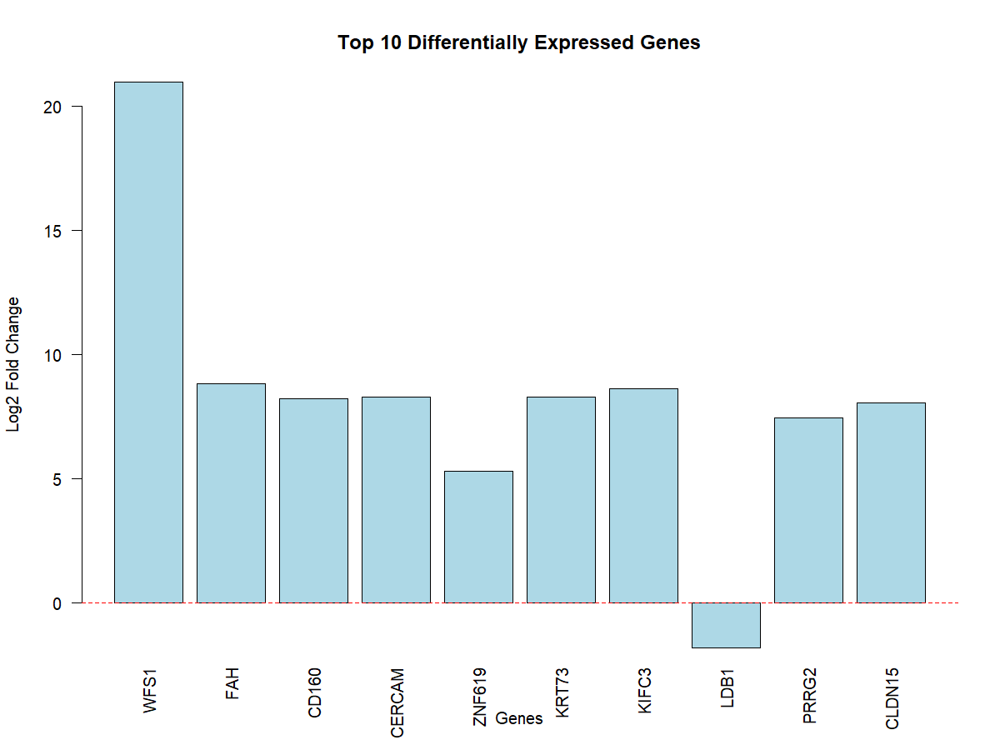
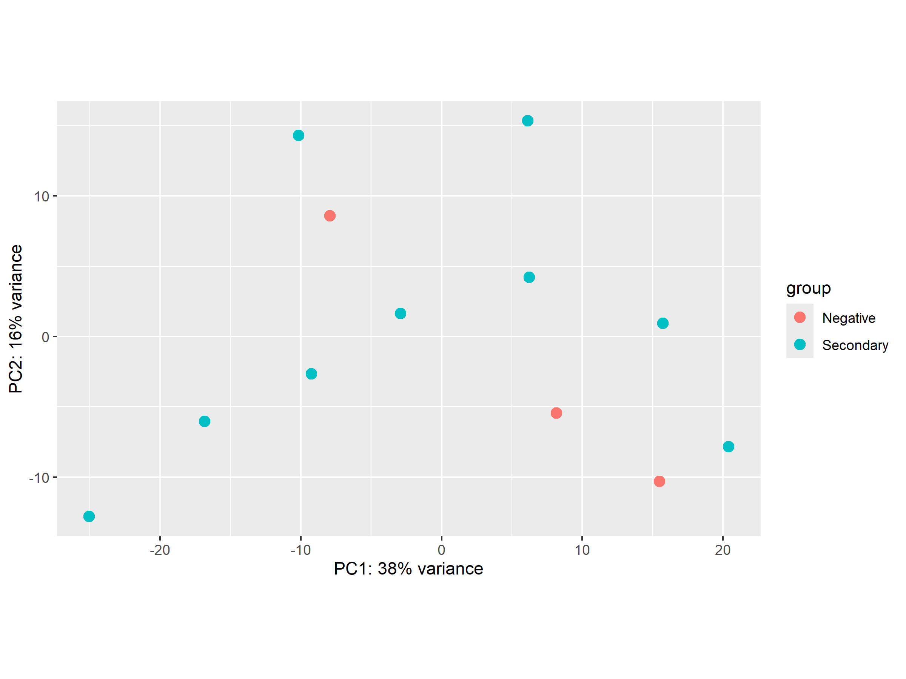

# Transcriptomic Analysis of CD4+ T-Cell Immune Responses Associated with Secondary Dengue Infection in a Sri Lankan Population

**Student registration number:** 2021/ASP/15\
**Dataset:** [NCBI GEO:
GSE97861](https://www.ncbi.nlm.nih.gov/geo/query/acc.cgi?acc=GSE97861)\
**Programming language:** R\
**Main packages:** DESeq2, ggplot2

## Abstract

This project explores gene expression differences in CD4+ T cells from
Sri Lankan donors with previous dengue exposure and dengue-negative
healthy controls. The analysis uses public RNA-sequencing data from the
GEO database (GSE97861). The main comparison focuses on TEMRA CD4+ T
cells, because this cell type is available for all 12 donors: 9 in the
secondary-exposure group and 3 in the negative-control group. After
checking and preparing the data, differential expression was analysed
using DESeq2. A total of 12,777 genes were tested, and 16 genes had an
adjusted p-value below 0.05. Fourteen showed higher estimated expression
and two showed lower estimated expression in the secondary group. The
small number of control samples means that the findings should be
treated as exploratory.

## 1. Introduction

Dengue is a mosquito-borne viral disease that affects many countries,
including Sri Lanka. People can be infected with different dengue virus
types. A previous dengue infection can influence the immune response to
a later infection.

CD4+ T cells are part of the body's immune system. They help coordinate
immune responses and can develop into different memory cell types. These
include central memory (TCM), effector memory (TEM) and terminally
differentiated effector memory (TEMRA) cells.

This project looks at gene expression in CD4+ T cells from people with
previous dengue exposure and people in the dengue-negative control
group. The main analysis focuses on TEMRA cells.

**Aim:** To identify genes with different expression levels in TEMRA
CD4+ T cells between donors in the secondary dengue-exposure group and
dengue-negative controls.

**Objectives:**

-   Download and inspect the public gene-expression dataset.
-   Check and prepare the expression data and sample information.
-   Select the TEMRA samples for the main comparison.
-   Use DESeq2 to identify genes with different expression between the
    two groups.
-   Create plots and tables to present the results.

## 2. Data

### 2.1 Data source

The data were obtained from the National Center for Biotechnology
Information (NCBI) Gene Expression Omnibus (GEO), under accession
**GSE97861**.

The dataset is titled *Transcriptomic profile of circulating naive, TCM,
TEM and TEMRA T cells in donors from Sri Lanka previously exposed to
dengue virus and healthy controls from Sri Lanka \[Cohort 1\]*.

Three files from the GEO dataset were used:

  --------------------------------------------------------------------------
  File                                   Description
  -------------------------------------- -----------------------------------
  `GSE97861_Raw_counts_cohort1.tsv.gz`   Raw gene read counts

  `GSE97861_TPM_cohort1.tsv.gz`          TPM gene-expression values

  `GSE97861_series_matrix.txt.gz`        Sample information and study
                                         details
  --------------------------------------------------------------------------

The original dataset contains 23,368 genes and 30 samples.

### 2.2 Sample information

The dataset includes 9 donors in the secondary dengue-exposure group and
3 dengue-negative healthy controls. The samples include four CD4+ T-cell
subsets.

  Cell type     Secondary   Negative    Total
  ----------- ----------- ---------- --------
  Naive                 6          0        6
  TCM                   6          0        6
  TEM                   6          0        6
  TEMRA                 9          3       12
  **Total**        **27**      **3**   **30**

Not every donor provided all four cell types. All 12 donors had a TEMRA
sample, while the three negative controls had only TEMRA samples. For
this reason, the main differential expression analysis uses the 12 TEMRA
samples only.

The terms *Secondary* and *Negative* refer to the groups described in
the original study. They should not be understood as proof that donors
were experiencing an active dengue infection when their samples were
collected.

## 3. Methods

The analysis was completed in RStudio using the script
`code/01_inspect_data.R`. The work was carried out in the following
steps.

### 3.1 Data import and checking

The raw count and TPM files were imported into R. The data were checked
for missing values, duplicated gene names, negative values and correct
numeric columns. The sample names in the expression files were also
checked.

### 3.2 Sample information preparation

The GEO series matrix was used to obtain the sample details, including
the donor, cell type and study group. The cell-type names were
standardised so that they could be used consistently during the
analysis.

### 3.3 Initial data exploration

TPM values were used for basic exploration and visualisation. Expression
distributions were examined using summary values and a boxplot. TPM
values were used for visualisation, not as input to the DESeq2
differential expression analysis.

### 3.4 TEMRA sample selection

The 12 TEMRA samples were selected from the full dataset. The sample
names were matched with the corresponding metadata, and the sample order
was checked before analysis.

### 3.5 Differential expression analysis

DESeq2 was used to compare the Secondary and Negative groups. Raw read
counts were used as input.

Genes with fewer than 10 counts in at least 3 samples were removed
before the analysis. After filtering, **12,777 genes** remained.

The analysis used the design formula `~ Group`, with Negative as the
reference group. The comparison was made between Secondary and Negative.
The Benjamini-Hochberg method was used by DESeq2 to adjust p-values for
multiple testing.

Genes with an adjusted p-value below 0.05 were considered statistically
significant for this project. A positive log2 fold change means higher
estimated expression in the Secondary group, while a negative value
means lower estimated expression.

### 3.6 Visualisation

The results were presented using:

-   A TPM expression boxplot for the initial data exploration.
-   A volcano plot to show the differential expression results.
-   A bar plot of the top 10 significant genes.
-   A CD160 expression plot to examine the values across individual
    TEMRA samples.
-   A PCA plot to explore similarities and differences between samples.

## 4. Results

### 4.1 Data checking and sample selection

The original count and TPM tables each contained 23,368 genes and 30
samples. The initial checks found no missing values or duplicated gene
names. The expression data and sample information were matched
successfully.

The main analysis included 12 TEMRA samples: 9 Secondary and 3 Negative.
After low-count filtering, 12,777 genes remained for differential
expression analysis.

### 4.2 Differential expression results

The DESeq2 analysis identified **16 significant genes** with an adjusted
p-value below 0.05.

-   **14 genes** had higher estimated expression in the Secondary group.
-   **2 genes** had lower estimated expression in the Secondary group.

The significant genes are shown below.

  Gene          Log2 fold change   Adjusted p-value Direction
  ----------- ------------------ ------------------ -----------
  WFS1                     20.97        1.47 × 10⁻⁷ Higher
  FAH                       8.83        9.63 × 10⁻⁶ Higher
  CD160                     8.22        3.72 × 10⁻³ Higher
  CERCAM                    8.30        3.72 × 10⁻³ Higher
  ZNF619                    5.31        3.72 × 10⁻³ Higher
  KRT73                     8.29        9.60 × 10⁻³ Higher
  KIFC3                     8.61        2.24 × 10⁻² Higher
  LDB1                     -1.81        2.24 × 10⁻² Lower
  PRRG2                     7.46        3.09 × 10⁻² Higher
  CLDN15                    8.04        3.24 × 10⁻² Higher
  DHTKD1                    3.14        3.24 × 10⁻² Higher
  LOC145474                 8.30        3.24 × 10⁻² Higher
  ALYREF                   -2.74        3.29 × 10⁻² Lower
  PIGN                      4.46        3.29 × 10⁻² Higher
  LRRN3                     7.64        4.03 × 10⁻² Higher
  ERBB2                     4.03        4.92 × 10⁻² Higher

The volcano plot shows the overall differential expression results. The
top 10 gene plot displays the genes with the smallest adjusted p-values.



*Figure 1. Volcano plot showing the differential expression results for
TEMRA samples.*



*Figure 2. Top 10 significant genes ranked by adjusted p-value.*

### 4.3 CD160 expression

CD160 was one of the significant genes. Its log2 fold change was
approximately 8.22, with an adjusted p-value of approximately 0.0037.
The normalised expression values were also examined for each of the 12
TEMRA samples.

The CD160 values were generally higher in the Secondary group, although
there was variation between individual samples. Values in the three
Negative samples were very low or zero. This observation follows the
direction of the DESeq2 result, but the small control group means that
it should be interpreted carefully.

The individual sample values are saved in
`results/CD160_expression.csv`.

### 4.4 Principal Component Analysis

PCA was performed using variance-stabilised count data. The plot uses
the 500 genes with the highest variance to show the main patterns in the
samples.



*Figure 3. PCA plot of the 12 TEMRA samples, coloured by study group.*

PCA is used here as an exploratory visualisation. It helps show whether
samples have similar or different overall expression patterns. It does
not by itself show that dengue exposure caused the differences.

## 5. Discussion

This project compared gene expression in TEMRA CD4+ T cells between
donors in the Secondary group and dengue-negative controls. The analysis
found 16 genes with adjusted p-values below 0.05. Most of these genes
had higher estimated expression in the Secondary group.

CD160 was one of the significant genes and showed higher estimated
expression in the Secondary group. The individual sample values showed
variation, but the overall pattern was consistent with the differential
expression result.

WFS1 had the largest estimated log2 fold change. However, very large
fold changes can occur when expression is low in one group or when a
result is strongly affected by a small number of samples. Therefore,
this result should be checked carefully and should not be interpreted as
a direct measure of biological effect size.

These results provide some candidate genes for further study. However,
this analysis cannot confirm the role of these genes in dengue immunity,
and it cannot show that previous dengue exposure caused the observed
expression differences.

### 5.1 Limitations

There are several limitations to this project:

1.  **Small control group:** Only three Negative TEMRA samples were
    available. This makes the results less stable and limits the
    strength of the conclusions.
2.  **One cohort:** The analysis uses Cohort 1 from Sri Lanka, so the
    findings may not apply to other populations.
3.  **Limited clinical information:** Clinical details such as dengue
    serotype, disease severity and time since infection were not
    included in this analysis.
4.  **Large fold changes:** Some genes have very large estimated fold
    changes. These values need further checking and independent
    validation.
5.  **Bulk RNA sequencing:** The data represent average gene expression
    in the sorted cell population rather than expression in individual
    cells.

## 6. Conclusion and Future Work

This project used public RNA-sequencing data to explore gene expression
differences in TEMRA CD4+ T cells between donors in the Secondary
dengue-exposure group and dengue-negative controls. After filtering,
12,777 genes were analysed, and 16 genes had an adjusted p-value below
0.05. Fourteen genes showed higher estimated expression and two showed
lower estimated expression in the Secondary group.

CD160 was one of the significant genes and showed a similar pattern in
the individual sample values. However, the small number of control
samples means that the findings should be treated as preliminary.

Future work could include:

-   Repeating the analysis with a larger group of samples.
-   Checking the important genes using an independent dataset.
-   Studying the biological functions of the significant genes in more
    detail.
-   Including more clinical information if it becomes available.

## 7. Reproducibility

### 7.1 Requirements

The project was completed using R and RStudio. The main packages are:

-   **DESeq2** -- differential expression analysis and PCA functions.
-   **ggplot2** -- plots and saving figures.
-   **Base R** -- data import, cleaning and summaries.

Install the required packages using:

``` r
install.packages("ggplot2")

if (!requireNamespace("BiocManager", quietly = TRUE)) {
  install.packages("BiocManager")
}

BiocManager::install("DESeq2")
```

To check the R and package versions used on your computer, run:

``` r
sessionInfo()
```

### 7.2 Download the data

Download the following files from the GEO supplementary files for
GSE97861 and place them inside the `data/raw/` folder:

-   [Raw
    counts](https://ftp.ncbi.nlm.nih.gov/geo/series/GSE97nnn/GSE97861/suppl/GSE97861_Raw_counts_cohort1.tsv.gz)
-   [TPM
    values](https://ftp.ncbi.nlm.nih.gov/geo/series/GSE97nnn/GSE97861/suppl/GSE97861_TPM_cohort1.tsv.gz)
-   [GEO series
    matrix](https://ftp.ncbi.nlm.nih.gov/geo/series/GSE97nnn/GSE97861/suppl/GSE97861_series_matrix.txt.gz)

The raw data folder is excluded from GitHub using `.gitignore`.
Therefore, the files need to be downloaded separately before running the
analysis.

### 7.3 Run the project

1.  Download or clone this GitHub repository.
2.  Open `Bioinformatics Project.Rproj` in RStudio.
3.  Download the three GEO files and place them in `data/raw/`.
4.  Open `code/01_inspect_data.R`.
5.  Run the script from the beginning, one section at a time.

The script creates the analysis tables and plots inside the `results/`
folder.

### 7.4 Project structure

``` text
Bioinformatics Project/
├── code/
│   └── 01_inspect_data.R
├── data/
│   └── raw/ 
├── results/
│   ├── differential_expression_all_genes.csv
│   ├── significant_genes.csv
│   ├── significant_gene_summary.csv
│   ├── CD160_expression.csv
│   ├── volcano_plot.png
│   ├── top_10_significant_genes.png
│   └── PCA_plot.png
├── .gitignore
├── Bioinformatics Project.Rproj
└── README.md
```

## 8. References

1.  Weiskopf, D., et al. (2017). *Transcriptomic profile of circulating
    naive, TCM, TEM and TEMRA T cells in donors from Sri Lanka
    previously exposed to dengue virus and healthy controls from Sri
    Lanka \[Cohort 1\].* NCBI Gene Expression Omnibus, GSE97861.
    <https://www.ncbi.nlm.nih.gov/geo/query/acc.cgi?acc=GSE97861>
2.  Love, M. I., Huber, W., & Anders, S. (2014). Moderated estimation of
    fold change and dispersion for RNA-seq data with DESeq2. *Genome
    Biology, 15*, 550. <https://doi.org/10.1186/s13059-014-0550-8>
3.  Benjamini, Y., & Hochberg, Y. (1995). Controlling the false
    discovery rate: A practical and powerful approach to multiple
    testing. *Journal of the Royal Statistical Society: Series B,
    57*(1), 289--300.
4.  R Core Team. *R: A Language and Environment for Statistical
    Computing.* R Foundation for Statistical Computing.
    <https://www.R-project.org/>
5.  Wickham, H. (2016). *ggplot2: Elegant Graphics for Data Analysis.*
    Springer.
