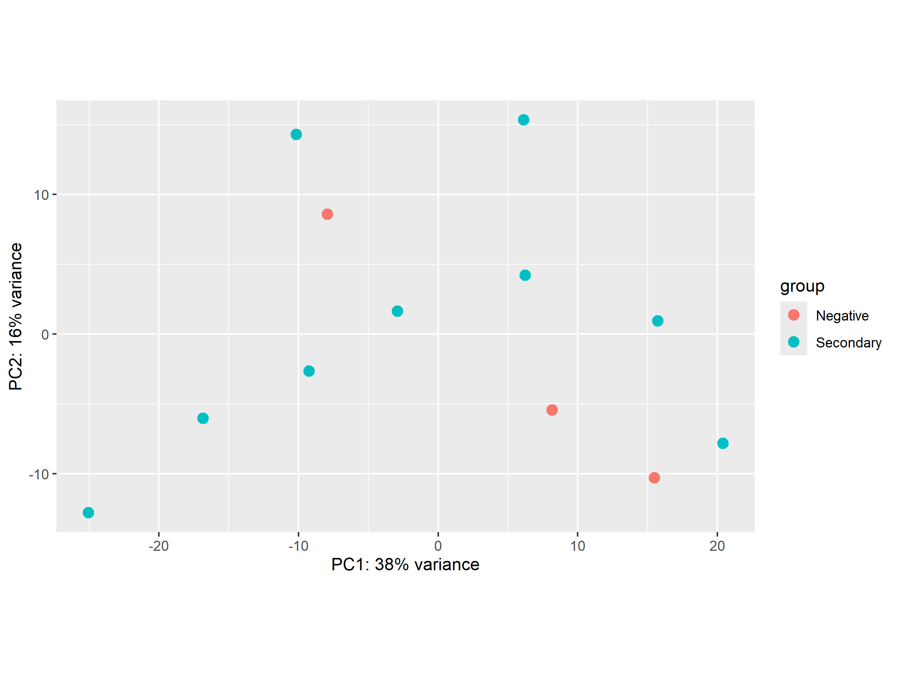
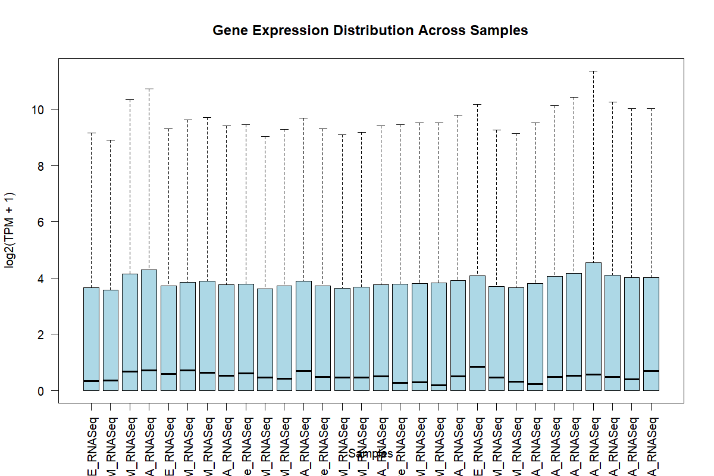
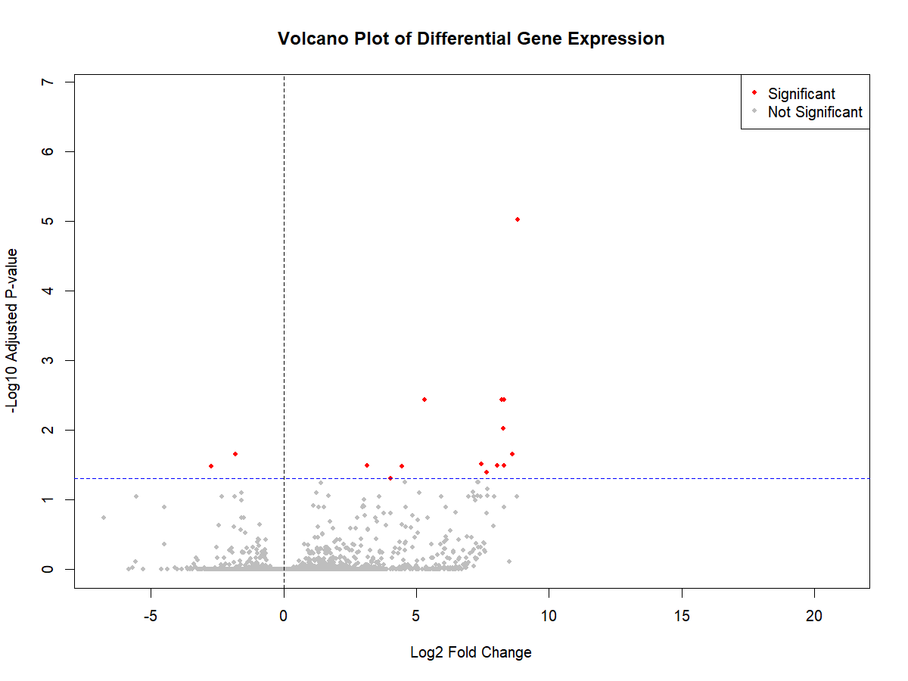
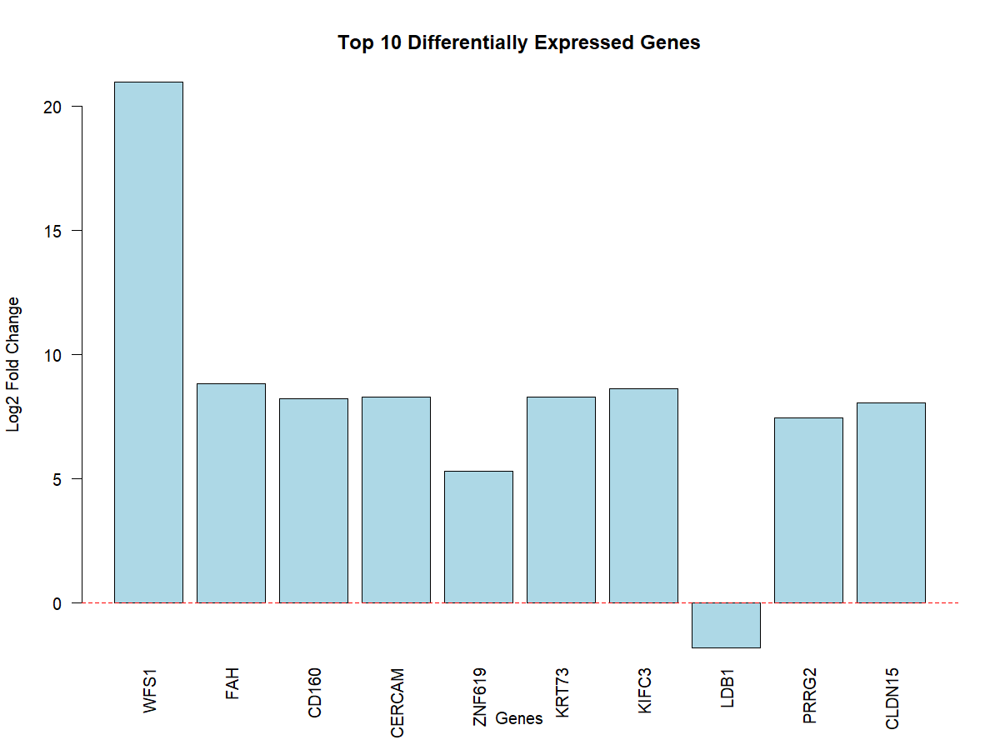

# Transcriptomic Differences in Circulating TEMRA CD4+ T Cells After Secondary Dengue Virus Exposure

**Student registration number:** _to be added_
**Dataset:** NCBI GEO accession [GSE97861](https://www.ncbi.nlm.nih.gov/geo/query/acc.cgi?acc=GSE97861)
**Language:** R (DESeq2, ggplot2, base R)

## Abstract

Dengue virus infects roughly 400 million people each year, and the immune correlates of protection remain incompletely understood. We analysed public bulk RNA-seq data from circulating CD4+ T-cell subsets of 9 Sri Lankan donors with secondary dengue infection and 3 dengue-negative healthy controls (GEO GSE97861). We restricted the analysis to terminally differentiated effector memory (TEMRA) CD4+ T cells (9 secondary vs 3 negative), filtered low-expression genes, and tested for differential expression with DESeq2 using a negative-binomial model. Of 12,777 genes tested, 16 had an adjusted p-value below 0.05: 14 were higher and 2 lower in secondary-exposure donors. The strongest signal was WFS1 (log2 fold change 20.97, adjusted p = 1.5 × 10⁻⁷), followed by FAH and CD160. The sample size is small and the top fold changes are large, so these results are hypothesis-generating and require validation in an independent cohort.

## 1. Introduction

Dengue is a mosquito-borne flavivirus infection and a major public health problem in tropical and subtropical regions, including Sri Lanka, where it is endemic. Prior infection with one dengue serotype is a known risk factor for more severe disease on later infection with another serotype, which makes the memory T-cell response to dengue of particular interest.

CD4+ T cells can be divided into naive, central memory (TCM), effector memory (TEM) and terminally differentiated effector memory (TEMRA) subsets. These subsets differ in their proliferative capacity, homing and effector function. Characterising the transcriptional profile of each subset in people with previous dengue exposure may help identify immune signatures associated with protection or pathology.

**Aim:** to identify genes whose expression differs in circulating TEMRA CD4+ T cells between donors with secondary dengue infection and dengue-negative healthy controls.

**Hypothesis:** TEMRA CD4+ T cells from previously exposed donors show a distinct transcriptional profile compared with dengue-negative controls.

## 2. Data

**Source:** NCBI Gene Expression Omnibus, series GSE97861 ("Transcriptomic profile of circulating naive, TCM, TEM and TEMRA T cells in donors from Sri Lanka previously exposed to dengue virus and healthy controls from Sri Lanka [Cohort 1]"). Platform GPL16791 (Homo sapiens). Associated publication: PubMed ID 29133794.

**Files used (stored in `data/raw/`, not tracked by git):**

| File | Content | Size |
|---|---|---|
| `GSE97861_Raw_counts_cohort1.tsv.gz` | Gene-level raw read counts | 23,368 genes × 30 samples |
| `GSE97861_TPM_cohort1.tsv.gz` | Gene-level TPM values | 23,368 genes × 30 samples |
| `GSE97861_series_matrix.txt.gz` | GEO series matrix (sample metadata) | 30 samples |

**Study design:** RNA-seq of sorted CD4+ naive, TCM, TEM and TEMRA T cells from cryopreserved PBMC of 9 donors with secondary dengue infection and 3 dengue-negative healthy controls.

**Sample table after cleaning** (`results/sample_information.csv`):

| Cell subset | Secondary | Negative (control) | Total |
|---|---|---|---|
| Naive | 6* | 0 | 6 |
| TCM | 6 | 0 | 6 |
| TEM | 6 | 0 | 6 |
| TEMRA | 9 | 3 | 12 |
| **Total** | **27** | **3** | **30** |

\* Naive samples were recorded as "NAIVE" or "Naive" in the GEO sample titles; these were standardised to uppercase during cleaning.

Not every donor has every subset: the 9 secondary-exposure donors contributed TEMRA samples and, for 6 of them, naive, TCM and TEM samples; the 3 negative controls contributed TEMRA samples only. The 12 TEMRA samples (9 Secondary, 3 Negative) form the input to the differential-expression analysis.

**Ethics and licence:** The data are publicly released by GEO and contain no direct identifiers (donors are coded GS0XXX). The data were used under the terms of the original submission; the GEO reuse policy applies. Users should cite the original study and GEO when reusing the data.

## 3. Methods

The workflow is implemented in `code/01_inspect_data.R` and runs in numbered stages:

1. **Import and inspection.** Raw counts and TPM values were read with `read.table()`. Dimensions, missing values (none), duplicated gene identifiers (none), numeric type, and negative values (none) were checked. Gene identifiers and sample names were confirmed to match between the count and TPM tables.
2. **Metadata extraction.** Sample titles and characteristics were parsed from the GEO series matrix into a table with GEO ID, sample name, group (Secondary / Negative), cell subset and donor. Cell-subset names were standardised to uppercase.
3. **Exploratory analysis of TPM values.** Per-sample mean TPM and distributions were summarised. Boxplots of log2(TPM + 1) were drawn for all samples to check comparability across libraries.
4. **Subset selection.** The 12 TEMRA samples were selected. Donor identifiers in the metadata were matched to the count-matrix column names (`<donor>_TEMRA_RNASeq`) and their order was verified.
5. **Differential expression with DESeq2** (Love, Huber & Anders, 2014). A `DESeqDataSet` was created from raw counts with design `~ Group`, with Negative set as the reference level. Genes with at least 10 counts in at least 3 samples were kept (12,777 genes). Size factors, dispersions and negative-binomial GLM fits were estimated with `DESeq()`. Wald tests were used for the Secondary vs Negative contrast, and p-values were adjusted with the Benjamini–Hochberg method (DESeq2 default).
6. **Significance.** Genes with adjusted p-value < 0.05 were called significant. Positive log2 fold change denotes higher expression in Secondary donors.
7. **Visualisation.** Volcano plot (log2 fold change vs −log10 adjusted p), top-10 significant gene plot, CD160 expression plot in TEMRA samples, and PCA of variance-stabilised counts (`vst()`, `plotPCA()`) coloured by group.

**Packages:** DESeq2 (differential expression, `vst`, `plotPCA`), ggplot2 (plots and saving figures), and base R (import, cleaning and summaries). Version numbers are given in the Reproducibility section.

**Why these methods:** DESeq2 models raw counts with a negative-binomial distribution and shrinks dispersion estimates, which is appropriate for small group sizes. Using raw counts rather than TPM avoids inflated variance for low-count genes. Low-expression filtering reduces multiple-testing burden and unreliable fold changes.

## 4. Results

### 4.1 Sample quality and structure

All 30 samples were present in both count and TPM tables, with no missing values, no negative values and no duplicated genes. Sample names matched between the count matrix and the metadata after standardisation. The PCA of variance-stabilised counts (`results/PCA_plot.png`) was used to check the major sources of variation between TEMRA samples.



*Figure 1. PCA of variance-stabilised counts for the 12 TEMRA samples, coloured by group (`plotPCA`, `intgroup = "Group"`).*



*Figure 2. Distribution of log2(TPM + 1) values across all 30 samples, used to check library comparability.*

### 4.2 Differential expression

Of 12,777 genes tested, **16 were significant** at adjusted p < 0.05 (`results/significant_genes.csv`):

- 14 higher in Secondary donors
- 2 lower in Secondary donors (LDB1, ALYREF)

**Table 1. Significant genes, TEMRA Secondary vs Negative (adjusted p < 0.05).** Source: `results/significant_gene_summary.csv`.

| Gene | log2 fold change | Adjusted p | Direction |
|---|---:|---:|---|
| WFS1 | 20.97 | 1.47 × 10⁻⁷ | Higher |
| FAH | 8.83 | 9.63 × 10⁻⁶ | Higher |
| CD160 | 8.22 | 3.72 × 10⁻³ | Higher |
| CERCAM | 8.30 | 3.72 × 10⁻³ | Higher |
| ZNF619 | 5.31 | 3.72 × 10⁻³ | Higher |
| KRT73 | 8.29 | 9.60 × 10⁻³ | Higher |
| KIFC3 | 8.61 | 2.24 × 10⁻² | Higher |
| LDB1 | −1.81 | 2.24 × 10⁻² | Lower |
| PRRG2 | 7.46 | 3.09 × 10⁻² | Higher |
| CLDN15 | 8.04 | 3.24 × 10⁻² | Higher |
| DHTKD1 | 3.14 | 3.24 × 10⁻² | Higher |
| LOC145474 | 8.30 | 3.24 × 10⁻² | Higher |
| ALYREF | −2.74 | 3.29 × 10⁻² | Lower |
| PIGN | 4.46 | 3.29 × 10⁻² | Higher |
| LRRN3 | 7.64 | 4.03 × 10⁻² | Higher |
| ERBB2 | 4.03 | 4.92 × 10⁻² | Higher |

The volcano plot (`results/volcano_plot.png`) shows the full set of tested genes with the adjusted p-value threshold marked, and the top-10 plot (`results/top_10_significant_genes.png`) shows the ten most significant genes.



*Figure 3. Volcano plot of differential expression, TEMRA Secondary vs Negative. x-axis: log2 fold change; y-axis: −log10 adjusted p-value. Dashed lines mark the fold-change cut-offs and the adjusted p = 0.05 threshold (`abline`, blue).*



*Figure 4. The ten most significant genes ranked by adjusted p-value.*

Of the 12,777 tested genes, 154 had undefined adjusted p-values (`NA`), which DESeq2 assigns when a gene is removed by independent filtering or contains outlier counts.

### 4.3 CD160

CD160, an immune-checkpoint-associated receptor expressed on cytotoxic CD4+ T cells, was higher in Secondary donors (log2 fold change 8.22, adjusted p = 3.7 × 10⁻³). Per-sample values are in `results/CD160_expression.csv`, and the plot is generated by the script.

## 5. Discussion

**Main finding.** TEMRA CD4+ T cells from donors with secondary dengue infection differ from dengue-negative controls in 16 genes at adjusted p < 0.05. Most of these (14/16) are higher in the exposed group.

**Biological interpretation.** Several of the top genes are plausibly linked to the immune state of the cell, but the link is speculative and needs functional testing:

- **CD160** is an NK-receptor-like molecule that marks highly differentiated, cytotoxic CD4+ T cells. Higher CD160 in secondary donors is consistent with a more differentiated, antigen-experienced TEMRA population after dengue exposure.
- **ERBB2** and **FAH** are linked to cell-signalling and metabolic pathways, respectively; their relevance to dengue immunity is not established.
- **LDB1** and **ALYREF** are lower in the exposed group. LDB1 is a transcriptional co-regulator and ALYREF is involved in mRNA export; both could reflect changes in transcriptional programmes of effector cells.
- **WFS1** has the largest fold change (≈ 2²¹). Such an extreme value is more often a feature of very low baseline expression or a small number of samples than of a true 2-million-fold change, and must be treated with caution until checked against raw counts per sample.

**Limitations.**

1. **Small sample size.** Only 3 negative controls were available for TEMRA cells. Power is low, and the controls may not represent the population as a whole.
2. **Unpaired analysis.** The model does not account for donor-level effects, even though each donor contributes samples from several subsets. Using a paired or donor-blocked design would be more powerful if the metadata were used as a covariate.
3. **Extreme fold changes.** Several genes have log2 fold changes above 5, which often arise from low counts. Filtering at ≥ 10 counts in ≥ 3 samples reduces but does not remove this.
4. **Cohort and population.** All donors are from Sri Lanka, from a single cohort (Cohort 1). Generalisability to other populations, serotypes or disease severity is unknown.
5. **No clinical variables.** Disease severity, time since infection, serotype and age were not used.
6. **Bulk sequencing.** Results reflect the average expression of the sorted population, not single cells.

**Real-world implications.** The results point to candidate genes for follow-up in an independent cohort and for functional studies of TEMRA CD4+ T-cell responses after dengue. They do not support any diagnostic or therapeutic use at this stage.

## 6. Conclusion and Future Work

Using public RNA-seq data (GSE97861) and DESeq2, we found 16 genes differentially expressed between TEMRA CD4+ T cells from donors with secondary dengue infection and dengue-negative controls, most of them higher in exposed donors. CD160 is among the significant genes. Future work should:

- validate the top genes (CD160, FAH, ERBB2, WFS1) by qPCR or flow cytometry in an independent cohort;
- repeat the analysis with a donor-blocked design, including all four subsets;
- check the WFS1 result against per-sample counts and consider a more robust method for extreme fold changes;
- perform pathway or gene-ontology enrichment (e.g. clusterProfiler) on the full ranked gene list;
- add clinical covariates when available.

## 7. Reproducibility

### 7.1 Requirements

- R (≥ 4.1 recommended; exact version to be recorded with `sessionInfo()`)
- Bioconductor and the **DESeq2** package
- **ggplot2**
- RStudio (optional; `Bioinformatics Project.Rproj` opens the project)

Install with:

```r
install.packages("ggplot2")
if (!requireNamespace("BiocManager", quietly = TRUE)) install.packages("BiocManager")
BiocManager::install("DESeq2")
```

Record the versions used for your run with:

```r
sessionInfo()
```

### 7.2 Data

Download the three files from the GEO supplementary directory for GSE97861 and place them in `data/raw/`:

- https://ftp.ncbi.nlm.nih.gov/geo/series/GSE97nnn/GSE97861/suppl/GSE97861_Raw_counts_cohort1.tsv.gz
- https://ftp.ncbi.nlm.nih.gov/geo/series/GSE97nnn/GSE97861/suppl/GSE97861_TPM_cohort1.tsv.gz
- https://ftp.ncbi.nlm.nih.gov/geo/series/GSE97nnn/GSE97861/suppl/GSE97861_series_matrix.txt.gz

(The series matrix can also be downloaded from the GEO series page.) The `data/raw/` folder is excluded from git (`.gitignore`), so the data must be downloaded separately.

### 7.3 Running the analysis

1. Clone the repository and open `Bioinformatics Project.Rproj` in RStudio, or set the working directory to the project root.
2. Place the three data files in `data/raw/`.
3. Run `code/01_inspect_data.R` from top to bottom. It writes all tables to `results/` and all figures to `results/`.

Expected outputs in `results/`:

| File | Content |
|---|---|
| `sample_information.csv` | Cleaned sample metadata (30 samples) |
| `differential_expression_all_genes.csv` | DESeq2 results for all 12,777 tested genes |
| `significant_genes.csv` | Genes with adjusted p < 0.05 |
| `significant_gene_summary.csv` | Gene, log2 fold change, adjusted p, direction |
| `CD160_expression.csv` | Per-sample CD160 expression in TEMRA cells |
| `tpm_expression_boxplot.png`, `volcano_plot.png`, `top_10_significant_genes.png`, `PCA_plot.png` | Figures |

### 7.4 Repository layout

```text
Bioinformatics Project/
├── code/
│   └── 01_inspect_data.R
├── data/
│   └── raw/            (GEO files, not tracked)
├── results/
├── .gitignore
├── Bioinformatics Project.Rproj
└── README.md
```

## 8. References

1. Weiskopf D, Tian Y, Babor M, O'Rourke P, Seumois G, Fu Z, Greenbaum J, Peters B, Vijayanand P, Sette A. (2017). Transcriptomic profile of circulating naive, TCM, TEM and TEMRA T cells in donors from Sri Lanka previously exposed to dengue virus. PubMed ID 29133794. *(Verify full title and journal against PubMed before submission.)*
2. Barrett T, Wilhite SE, Ledoux P, et al. (2013). NCBI GEO: archive for functional genomics data sets—update. *Nucleic Acids Research*, 41(D1), D991–D995.
3. Love MI, Huber W, Anders S. (2014). Moderated estimation of fold change and dispersion for RNA-seq data with DESeq2. *Genome Biology*, 15, 550.
4. Benjamini Y, Hochberg Y. (1995). Controlling the false discovery rate: a practical and powerful approach to multiple testing. *Journal of the Royal Statistical Society: Series B*, 57(1), 289–300.
5. Wickham H. (2016). *ggplot2: Elegant Graphics for Data Analysis*. Springer.
6. R Core Team. (2024). *R: A Language and Environment for Statistical Computing*. R Foundation for Statistical Computing, Vienna. https://www.R-project.org/
